# ZXTeensyIF1 Menu ROM User Guide

The Menu ROM lets you choose a Spectrum ROM, load games and snapshots, mount disk
images, configure peripherals, and save or restore a running session.

The screenshots show example files, configurations and status values. Available
options depend on your configuration, the files on your SD card, and the
peripherals connected to your ZXTeensyIF1.

- [Opening and navigating the menu](#opening-and-navigating-the-menu)
- [Main Menu](#main-menu)
- [Browsing the SD card](#browsing-the-sd-card)
- [Loading a system ROM](#loading-a-system-rom)
- [Loading a saved configuration](#loading-a-saved-configuration)
- [Editing the configuration](#editing-the-configuration)
- [Setting the clock and timezone](#setting-the-clock-and-timezone)
- [Transferring files over WiFi](#transferring-files-over-wifi)
- [Using the In-Game Menu](#using-the-in-game-menu)
- [Saving and loading states](#saving-and-loading-states)
- [Browsing a tape](#browsing-a-tape)
- [Applying POK trainers](#applying-pok-trainers)
- [About and diagnostics](#about-and-diagnostics)

## Opening and navigating the menu

To open the main menu, use one of these methods:

- Enable **Boot into Menu** to open it at power on.
- Hold the ZXTeensyIF1 button while resetting the Spectrum.
- Hold Reset for longer than five seconds.

With **Enable In-game Menu** enabled, press the ZXTeensyIF1 button while a
program is running to open the In-Game Menu.

Use the Spectrum cursor keys to navigate, and Enter to select.

The cyan bar marks the highlighted entry. A tick shows an enabled option or
selected item. The bar on the right shows the current page within the menu.
Moving down past the last entry on a page advances to the next page when one is
available; moving up from the first entry returns to the previous page.

Select **Back** to return from a submenu. In the file browser, select **..** to
move up a directory; selecting it at the root returns to the main or in-game
menu.

## Main Menu

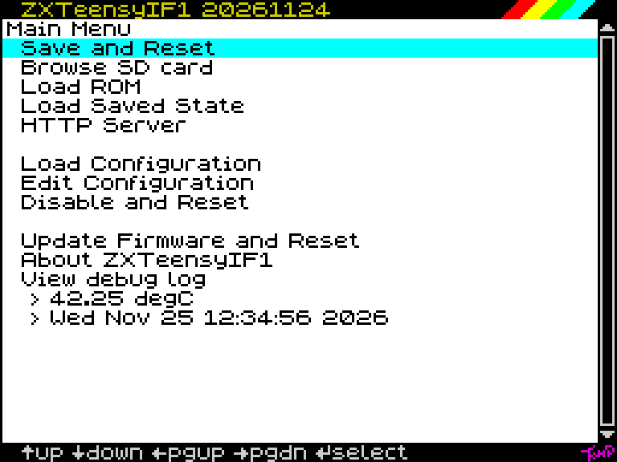

The Main Menu is the starting point for setting up the machine before running a
program.

| Option | What it does |
|--------|--------------|
| **Save and Reset** | Saves configuration changes and resets into the selected ROM and peripheral configuration. |
| **Browse SD card** | Opens the file browser to load files or mount disk images. |
| **Load ROM** | Selects a system soft ROM or cartridge from the `ROMS` directory. |
| **Load Saved State** | Restores a previously saved session. |
| **HTTP Server** | Starts or stops WiFi access to files on the SD card. |
| **Load Configuration** | Loads a named configuration from `ZXTEENSY/CONFIGS`. |
| **Edit Configuration** | Changes the boot options and enabled peripherals. |
| **Disable and Reset** | Temporarily disables the ZXTeensyIF1 and resets the Spectrum. |
| **About ZXTeensyIF1** | Displays the firmware version and credits. |

Temperature and clock information appear towards the bottom. **View debug log**
appears when debug log information is available.

### Updating the firmware

**Update Firmware and Reset** appears when `ZXTEENSY.HEX` is present in the root
of the SD card. Select it to install the update, then allow the Spectrum to
reset. The update takes about a minute; keep the power on until it finishes.

## Browsing the SD card

Choose **Browse SD card** from the Main Menu or In-Game Menu.

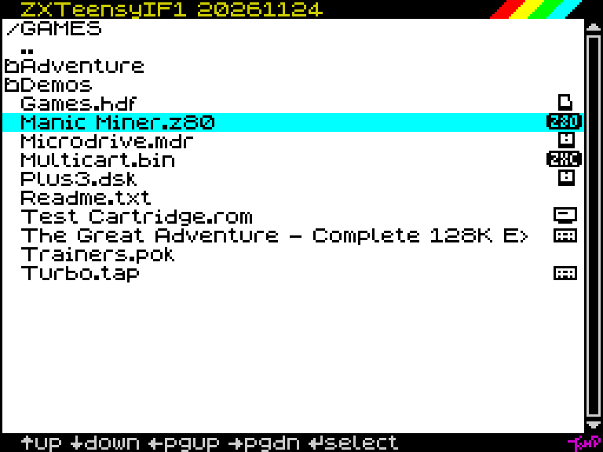

The header shows the current directory. Select a folder to open it, or **..** to
go up one level. Icons on the right identify cartridges, snapshots, disk images
and tapes.

For very large directories, **Next Pages** and **Previous Pages** entries move
between batches of files. Use left and right to move between pages at a time.

| File extension | Browser action |
|----------------|----------------|
| `.rom`, `.bin` | Opens the ROM cartridge type selector. |
| `.mld` | Loads a Dandanator cartridge. |
| `.z80`, `.sna` | Loads a Spectrum snapshot. |
| `.hdf`, `.img` | Offers DivMMC drive targets. |
| `.dsk` | Offers Spectrum +3 floppy drive targets. |
| `.mdr` | Loads through the Microdrive Emulator, when available. |
| `.tap`, `.tzx` | Loads a tape image. |
| `.pok` | Opens the trainer selector when browsing from the In-Game Menu. |
| Other | Opens a menu asking how to use the file. |

Loading a cartridge or snapshot replaces the running program. Mounting a disk
image attaches it to a drive for use by the Spectrum's software.

### Reading a long filename

A filename ending in **>** has been shortened to fit the list. Select it to
expand the name across additional lines.

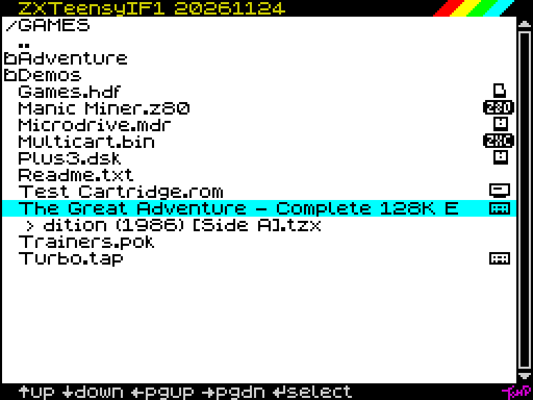

Press **Enter** again to open the file or perform its usual action. Press any
direction key to collapse the name and return to browsing.

### Choosing how to open a file

Files without a recognised extension show the available loading and mounting
actions.

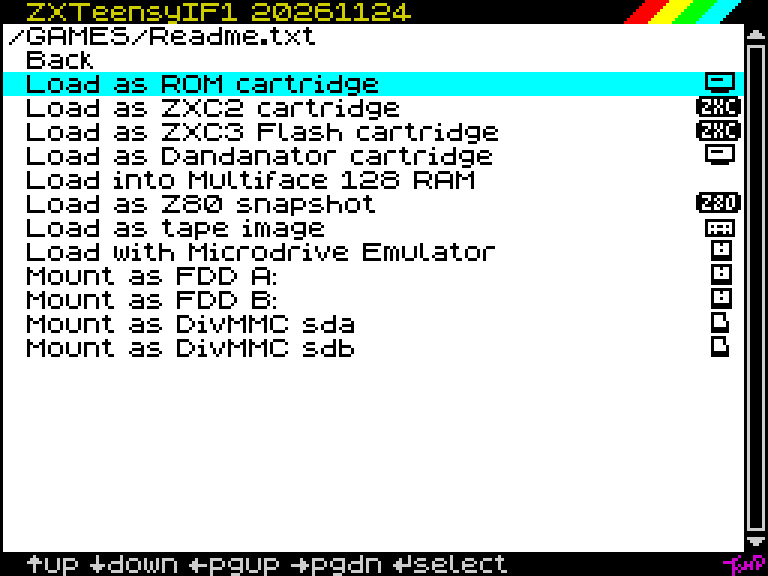

Choose the action that matches the file's actual format. **Back** returns to the
directory. Some actions appear only when their supporting peripheral or ROM is
available.

For `.rom` and `.bin` files, the shorter cartridge menu lets you choose a ROM
cartridge, ZXC2 cartridge, ZXC3 Flash cartridge, or Dandanator cartridge.

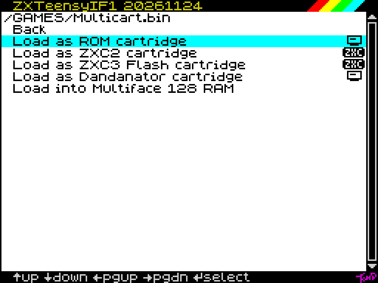

When browsing in-game with Multiface 128 available, **Load into Multiface 128
RAM** is also offered. This loads the image into Multiface RAM for use with the
Multiface, rather than selecting a system soft ROM.

### Mounting a DivMMC disk image

Select an `.hdf` or `.img` file, then choose **Mount as DivMMC sda** or
**Mount as DivMMC sdb**.

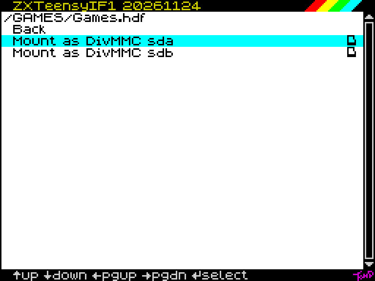

The menu returns to the Main Menu or In-Game Menu after mounting. From the Main
Menu, choose **Save and Reset** to start with the selected image. From the
In-Game Menu, choose **Back** to resume using it.

The physical SD card can also be assigned to a DivMMC drive through
**Edit Configuration**. This allows software to access the SD card and an image
file as separate drives.

### Mounting a Spectrum +3 floppy image

Select a `.dsk` file, then choose **Mount as FDD A:** or **Mount as FDD B:**.

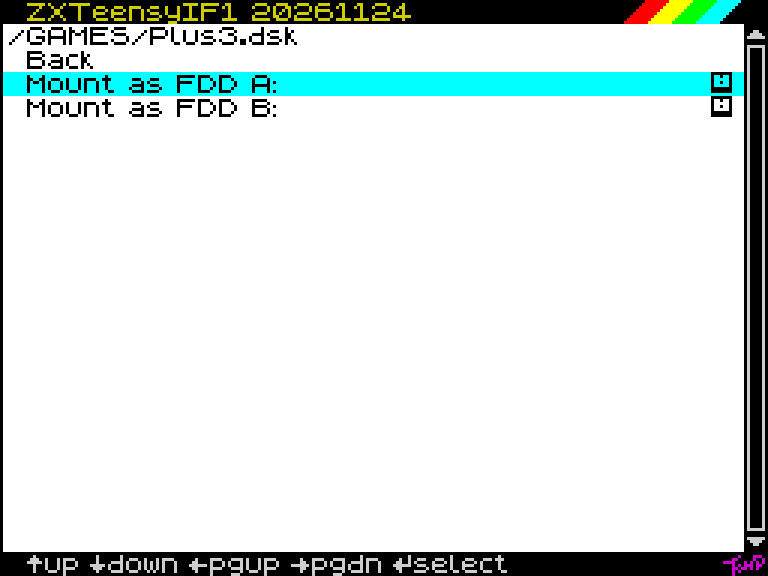

Use A: for the first drive and B: for the second. When mounting from the Main
Menu, the FDC is enabled automatically; choosing B: also enables the second
drive. In-game mounting requires the FDC and the selected drive to be enabled.

## Loading a system ROM

Choose **Load ROM** from the Main Menu. This browser lists files in the SD card's
`ROMS` directory.

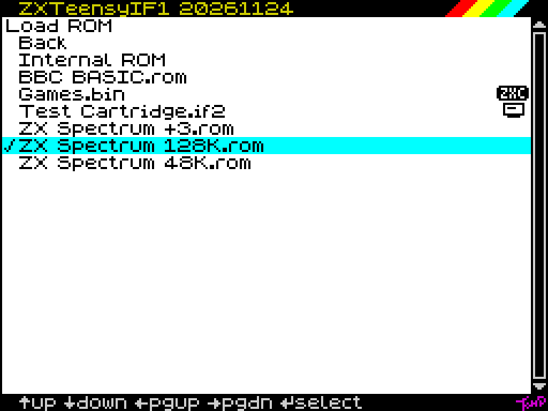

- Select a `.rom` file once to make it the current system soft ROM. A tick marks
  the selection.
- Select the checked ROM again to reset into it immediately, or return to the
  Main Menu and choose **Save and Reset**.
- Select **Internal ROM** to use the Spectrum's own ROM. Selecting it again when
  already checked also resets the machine.

In this menu, `.bin` files are treated as ZXC2 cartridges and other file types
as Interface 2 cartridges. These cartridge selections load immediately. Use
**Browse SD card** when you need to choose a different interpretation for a ROM
or binary file.

## Loading a saved configuration

Choose **Load Configuration** to list the `.CFG` files in
`ZXTEENSY/CONFIGS`. The menu displays each filename without its extension.

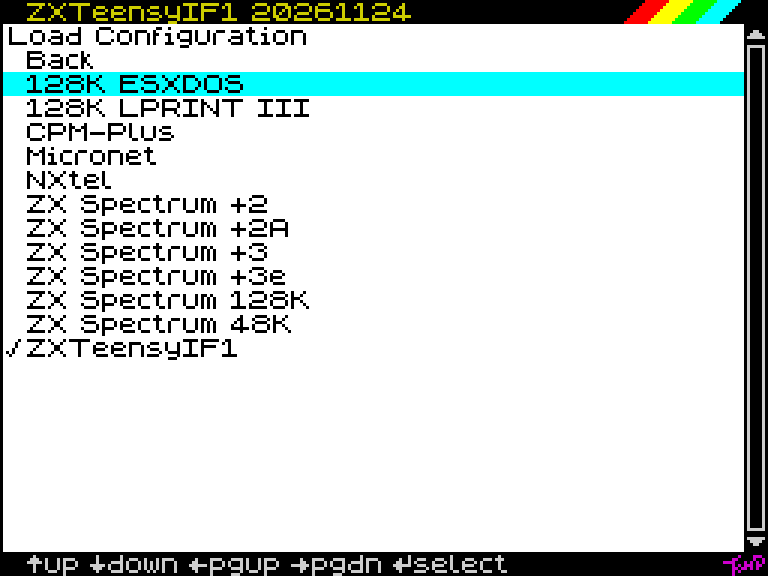

Select a configuration once to load its settings. The tick identifies the
selected configuration. Select that checked entry again to reset into it, or
choose **Back** to review the settings before resetting.

Named configurations provide starting points for different ROM and peripheral
combinations. Subsequent menu changes are stored in the current configuration
file, `ZXTEENSY/ZXTEENSY.CFG`; they do not overwrite the named preset.

## Editing the configuration

Choose **Edit Configuration** from the Main Menu. Select an option to toggle its
tick. Additional options appear beneath a peripheral when it is enabled.

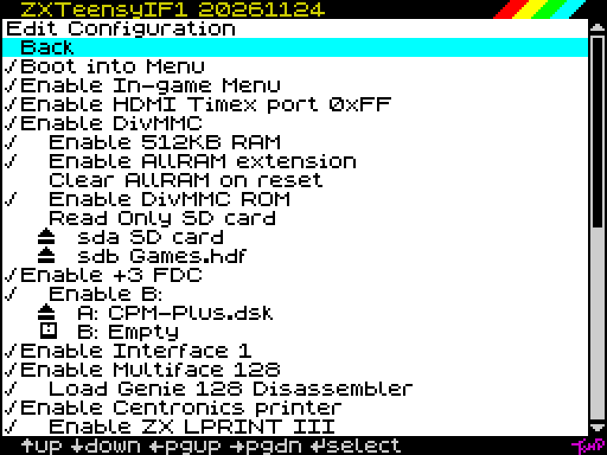

The first page in this example contains the boot options, HDMI video setting,
DivMMC configuration, floppy drives and peripheral ROMs.

| Setting or group | Purpose |
|------------------|---------|
| **Boot into Menu** | Opens the Main Menu at power on. |
| **Enable In-game Menu** | Allows the ZXTeensyIF1 button to open the menu during a program. |
| **Enable HDMI Timex port 0xFF** | Enables Timex video mode control for the connected HDMI output. |
| **Enable DivMMC** | Enables the DivMMC interface. Its nested options control 512KB RAM, the AllRAM extension and the DivMMC ROM. |
| **Clear AllRAM on reset** | Clears the AllRAM control register on ordinary resets. It does not erase DivMMC RAM contents. |
| **Read Only SD card** | Prevents writes through DivMMC to the physical SD card when it is mounted as a drive. |
| **Enable +3 FDC** / **Enable B:** | Enables the floppy controller and, optionally, its second drive. |
| **Enable Interface 1** | Makes the Interface 1 peripheral available. |
| **Enable Multiface 128** | Makes the Multiface available; its nested option can load the Genie 128 disassembler. |
| **Enable Centronics printer** | Enables printer output to files on the SD card. |
| **Enable ZX LPRINT III** | Enables the LPRINT III printer interface when its ROM is available. |

Resetting into the Main Menu always clears the AllRAM control register. Ordinary
resets preserve it unless **Clear AllRAM on reset** is enabled.

Drive entries show the mounted filename or **Empty**. Select an entry with the
eject symbol to unmount that disk. Where offered, **Mount SD card as sda** or
**Mount SD card as sdb** assigns the physical card to that drive. Otherwise,
use **Browse SD Card** from the main menu to assign images.

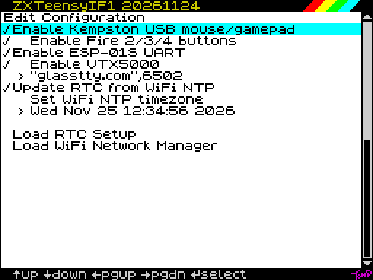

Further options cover input, printing, WiFi and setup tools:

| Setting or group | Purpose |
|------------------|---------|
| **Enable Kempston USB mouse/gamepad** | Enables supported USB input devices. |
| **Enable Fire 2/3/4 buttons** | Enables the extra gamepad fire buttons. |
| **Enable ESP-01S UART** | Enables the ESP-01S serial interface. |
| **Enable VTX5000** | Enables the modem interface; the configured destination is shown beneath it. |
| **Enable eLeMeNt ZX registers** | Offers the alternative register interface when the UART is enabled and VTX5000 is disabled. |
| **Update RTC from WiFi NTP** | Enables clock synchronisation over WiFi. |
| **Load RTC Setup** | Starts the supplied clock setup utility. |
| **Load WiFi Network Manager** | Starts the supplied WiFi configuration utility. |

The setup utilities appear when their snapshot files are present in `ZXTEENSY`.
After making changes, choose **Back**, then **Save and Reset** to save and start
with the new configuration.

## Setting the clock and timezone

For automatic clock setup, configure the ESP-01S WiFi connection with
**Load WiFi Network Manager**, then enable **Update RTC from WiFi NTP** in
**Edit Configuration**.

Choose **Set WiFi NTP timezone** to select the offset used when setting the clock
from NTP.

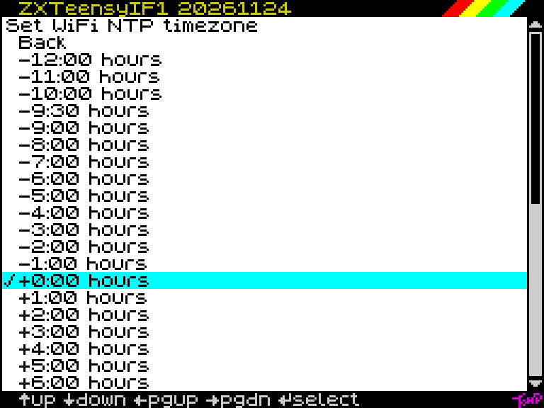

The tick marks the selected offset. **+0:00 hours** uses UTC.

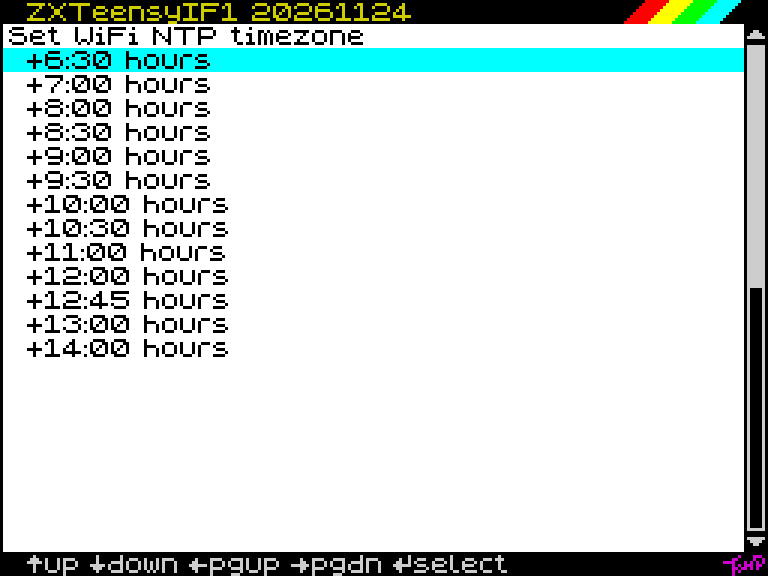

Selecting an offset returns to **Edit Configuration**. Choose **Save and Reset**
after finishing your changes. The clock status shows **Waiting for WiFi NTP**
while synchronisation is pending, or **RTC not set** when no time is available.
Use **Load RTC Setup** if you want to set the clock with the supplied utility.

## Transferring files over WiFi

Choose **HTTP Server** from the Main Menu.

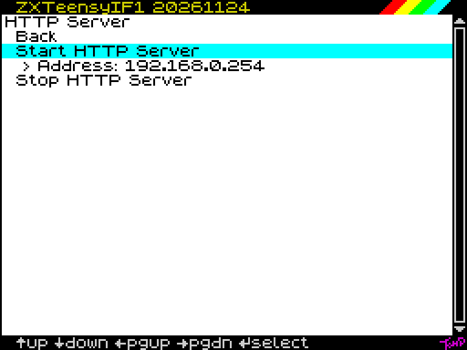

1. Select **Start HTTP Server**.
2. Wait for the menu to show the ESP-01S's address.
3. On a computer on the same network, open that address with `http://` in a web
   browser to browse and download files. Use a WebDAV client such as WinSCP to
   upload files.
4. Select **Stop HTTP Server** when finished.

Use the address shown on your Spectrum; `192.168.0.254` in the screenshot is an
example. If the status reports that it is waiting for WiFi, an IP address or
NTP, allow that step to complete and select **Start HTTP Server** again.

The server stops when the machine resets. For transfer details, see
[WebDAV class 1 support](README.md#webdav-class-1-support).

## Using the In-Game Menu

Enable **Enable In-game Menu** in the main configuration, then press the
ZXTeensyIF1 button while a program is running.

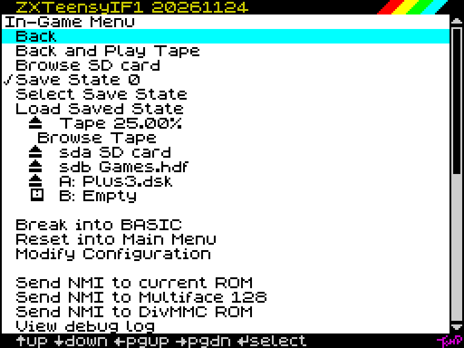

Choose **Back** to resume the program. **Back and Play Tape** resumes it and
starts or continues playback of the loaded tape.

The menu also provides file browsing, save states, tape controls and drive
entries. Select a mounted drive's eject entry to unmount it.

A **>** before a drive icon indicates that the drive is locked in use. Selecting
that entry unlocks the drive controls, after which the eject action can be
selected. Only change disks when the running software is ready for a disk change.

Other actions include:

- **Break into BASIC** attempts to return to the Spectrum's BASIC environment.
- **Reset into Main Menu** resets the machine and ends the current session.
- **Modify Configuration** opens the settings that can be changed in-game.
- **Send NMI to current ROM**, **Send NMI to Multiface 128** and
  **Send NMI to DivMMC ROM** hand control to the corresponding NMI handler when
  available.

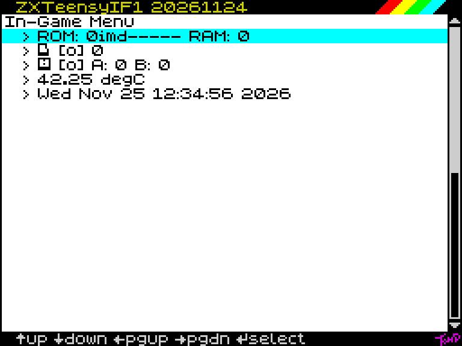

### Reading the status lines

The status lines show ROM and RAM banking, disk activity, temperature and time.
For example, the screenshot shows `ROM: 0imd----- RAM: 0`.

The first character after **ROM:** identifies the selected system soft ROM bank
(`0` to `3`), or **-** when none is reported. The remaining characters describe
peripheral ROMs:

| Indicator | Peripheral |
|-----------|------------|
| **i / I** | Interface 1 |
| **m / M** | Multiface 128 |
| **d / D** | DivMMC |
| **l / L** | ZX LPRINT III |
| **v / V** | VTX5000 modem |
| **z / Z** | ZXC2 or ZXC3 cartridge |
| **d / D**, after the cartridge indicator | Dandanator cartridge |
| **s / S** | Snapshot loader |

Lowercase means the peripheral is enabled or present; uppercase means its ROM
is paged in. A dash means no indicator is set for that position. When DivMMC is
paged in, its uppercase **D** replaces the Multiface indicator. These are paging
flags, so several indicators can appear together even though ROM priority
determines which one is visible to the Spectrum.

**RAM:** shows the bank selected by the Spectrum's 128K paging register,
normally the 16KB bank at `0xC000`. **LOCK** means 128K paging is locked.

Additional lines appear for the peripherals in use:

- **ZXC2/ZXC3 cartridge icon:** the cartridge type and selected 16KB bank.
  **LOCK** means cartridge banking is locked.
- **SD card icon:** **[*]** means a DivMMC drive is selected; **[o]** means
  neither drive is selected. The number is the selected 8KB RAM bank, or a
  16KB AllRAM page when prefixed with **D**. **MAPRAM** reports that MAPRAM mode
  is enabled.
- **Floppy disk icon:** **[*]** means the motor is on; **[o]** means it is off.
  The numbers beside **A:** and **B:** are the drives' current track (cylinders).
- **degC:** the Teensy's temperature, followed by the RTC date and time when
  available.

### Changing settings in-game

Choose **Modify Configuration** to change the available settings without
returning to the Main Menu.

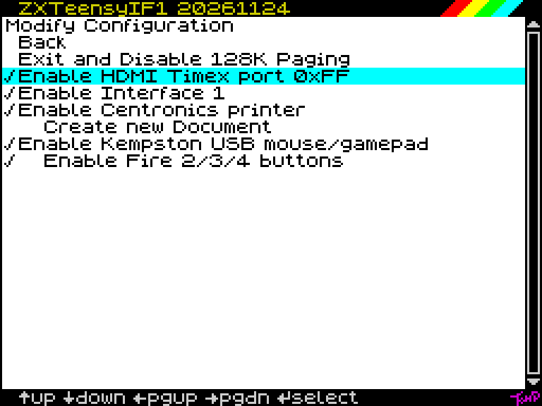

Depending on the current configuration, this menu can switch between Interface 1
and DivMMC, toggle printer output, change USB input settings, or change HDMI
Timex support. **Exit and Disable 128K Paging** appears for supported 48K soft
ROM configurations on a 128K machine.

With printer output enabled, **Create new Document** closes the current output
file so that subsequent output starts a new document. Printer files are named
`printer-YYYYMMDD-HHMMSS.txt`, with a numeric suffix if needed.

Choose **Back** to return to the In-Game Menu, then **Back** again to resume.

## Saving and loading states

A saved state records the Spectrum session together with the associated
peripheral state. User save slots are numbered **0 to 14**.

### Saving a session

Choose **Select Save State** from the In-Game Menu.

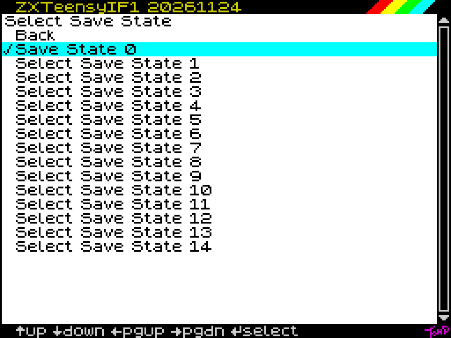

1. If the slot you want is not already checked, select it once. The tick moves
   to it and its label changes to **Save State N**.
2. Select the checked **Save State N** entry to save the session.
3. When saving finishes, return to the In-Game Menu and choose **Back** to resume.

You can also use **Save State N** directly from the In-Game Menu to save to the
currently selected slot. Saving replaces any previous state in that slot.

The files are stored under `ZXTEENSY/STATE/<slot>/`, including a snapshot and a
screen image. Keep the slot's files together when copying a saved state.

### Loading a session

Choose **Load Saved State** from either the Main Menu or In-Game Menu.

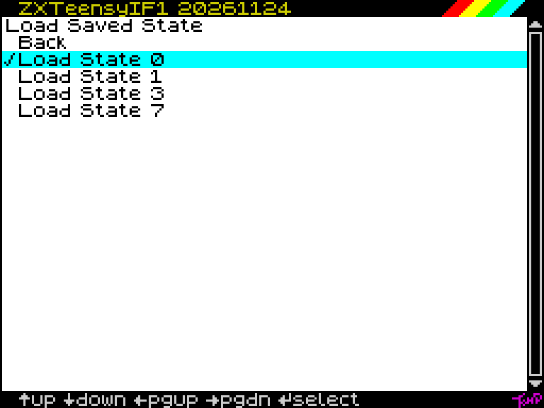

Only populated slots are listed. Select **Load State N** to preview the saved
Spectrum screen. The preview fills the display and hides the menu text:

- Press **Enter** to confirm and restore the session.
- Press any direction key to return without loading.

Loading replaces the current session. A successfully saved or loaded state is
also selected for restoration at power on. Hold the ZXTeensyIF1 button during
power on to bypass automatic restoration.

## Browsing a tape

Load a `.tap` or `.tzx` file through **Browse SD card**, then open
**Browse Tape** from the In-Game Menu.

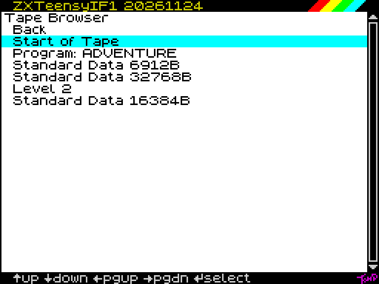

Select **Start of Tape** to rewind, or select a named block to seek to it. The
menu returns to the In-Game Menu. Choose **Back and Play Tape** to resume the
program and play from that position.

Tape progress appears as a percentage beside the tape's eject entry. Selecting
that entry removes the loaded tape. Tape playback overdrives the ULA and locks
the keyboard while playing; use the ZXTeensyIF1 button to pause playback and
access the menu.

## Applying POK trainers

Open **Browse SD card** from the In-Game Menu and select a `.pok` file for the
running game.

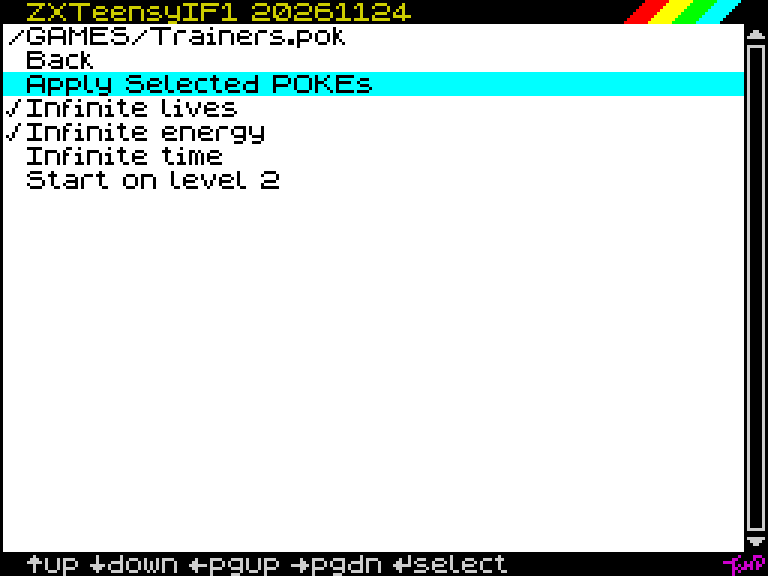

1. Select each trainer you want to enable. A tick marks a selected trainer;
   selecting it again clears the tick.
2. Choose **Apply Selected POKEs** to apply the checked trainers and resume the
   session.
3. Choose **Back** if you want to leave without applying them.

The apply option appears when at least one trainer is selected. Trainers that
ask for a value using POK value `256` are not supported and cannot be enabled.
Slot **15** is reserved for applying trainers and is not a user save slot.

## About and diagnostics

Choose **About ZXTeensyIF1** from the Main Menu to view the firmware version,
included components and project credits.

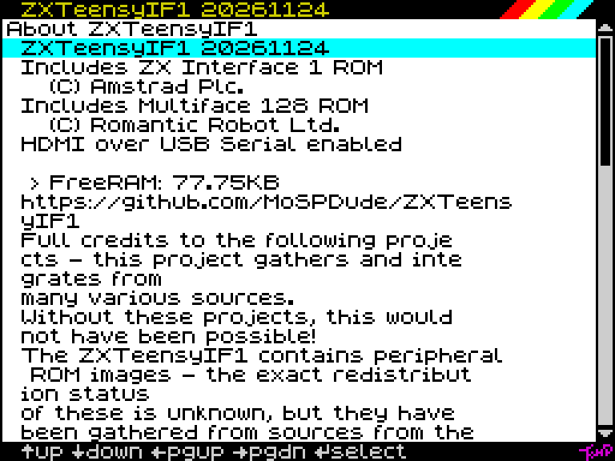

Use left and right to move through additional credit pages. Press **Enter** on
an entry to return to the Main Menu.

When **View debug log** is available, it shows diagnostic messages and the free
RAM reading. Press **Enter** on an entry to return to the menu that opened it.

[Return to the README](README.md#using-the-menu-rom)
